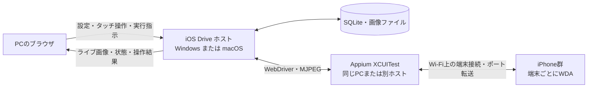

# システム構成

## 構成と経路

手動操作はブラウザで確定したジェスチャーをホストが受け付け、端末のAppiumセッションへ送る。映像はWDAのMJPEGをホストが中継する。判断用の画像はホストがAppiumから別途取得する。自動実行中は、シナリオ実行器が同じ端末操作インターフェースを利用する。

| 構成 | iOS Driveホスト | AppiumとiPhone |
| --- | --- | --- |
| 初期開発 | Mac | 同じMacのAppiumからWi-Fiで接続 |
| Windows直接運用 | Windows | 同じWindowsのAppiumからWi-Fiで接続。対象環境で事前に実機検証 |
| 接続分離 | WindowsまたはMac | LAN内の別Mac上のAppiumからWi-Fiで接続 |

AppiumのURLは端末設定が参照する。接続構成の変更でシナリオや画面操作の手順は変わらない。映像の取得先は別に管理し、AppiumのURLだけでMJPEGの到達性を判断しない。

## 採用技術

| 領域 | 初版案 |
| --- | --- |
| ブラウザ | TypeScript、React、Vite。開発時は個別に起動し、配布時はビルド済み静的ファイルをホストから配信。 |
| ホスト | Python、FastAPI、Uvicorn。HTTP RESTで設定・実行操作、WebSocketでイベント・入力・プレビューを処理。 |
| 端末 | Appium XCUITest、WDA、実機用RemoteXPC。Appiumは別プロセスとして設定・起動する。 |
| 画像処理 | OpenCVでテンプレート照合。CPUで開始し、処理時間を測って並行数を調整。 |
| データ | SQLiteで端末、シナリオ版、実行履歴を保存。PNGや失敗画像はホストのデータディレクトリに保存。 |

1台のiOS Driveホストが実行スケジューラとデータを持つ。Appium接続先は複数登録でき、必要に応じて物理ホストへ端末を分散できる。ホスト自体の冗長化や、複数ホストで同じSQLiteファイルを共有する構成は初版の範囲外。

## 設計上の境界

- ブラウザと実行器にはAppiumのセッション情報やWDAのポートを直接管理させない。端末接続層が接続・再作成・撮影・操作を担当する。
- AppiumやWDAをブラウザに公開しない。ブラウザはiOS Driveホストだけと通信する。
- Windows対応のため、シナリオ判定にApple Visionを依存させない。将来OCRを追加する場合は採用するエンジンと動作環境を別途決める。

[Appium XCUITestの構成](https://appium.github.io/appium-xcuitest-driver/latest/overview/) · [Windowsホストの条件](https://appium.github.io/appium-xcuitest-driver/latest/guides/non-macos-hosts/)
